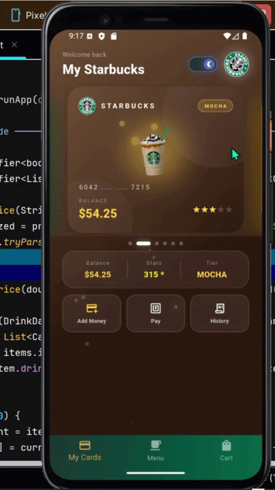
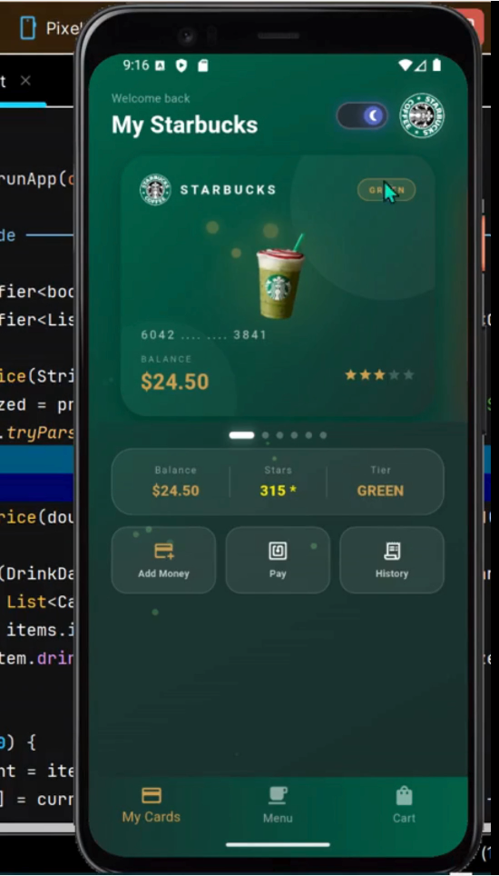
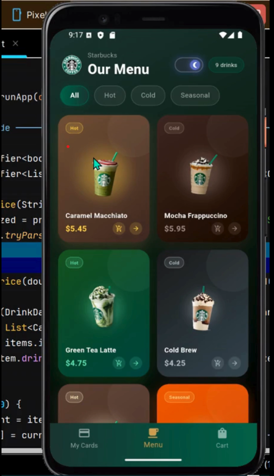
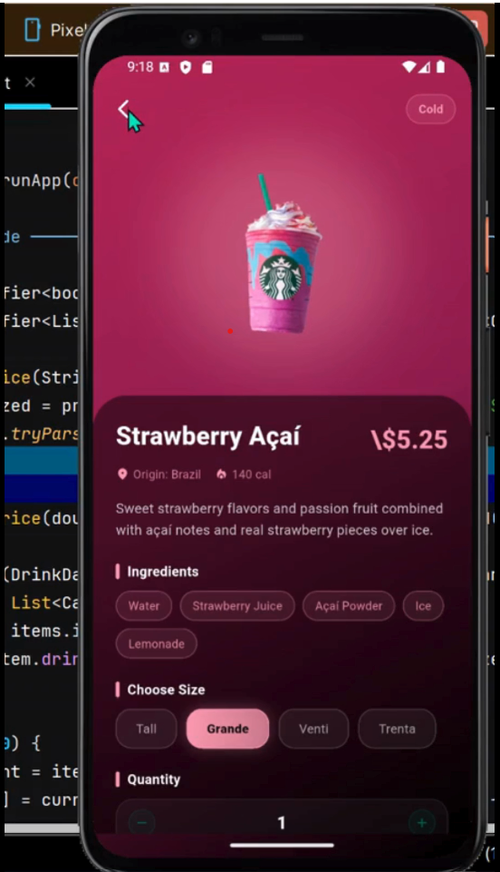
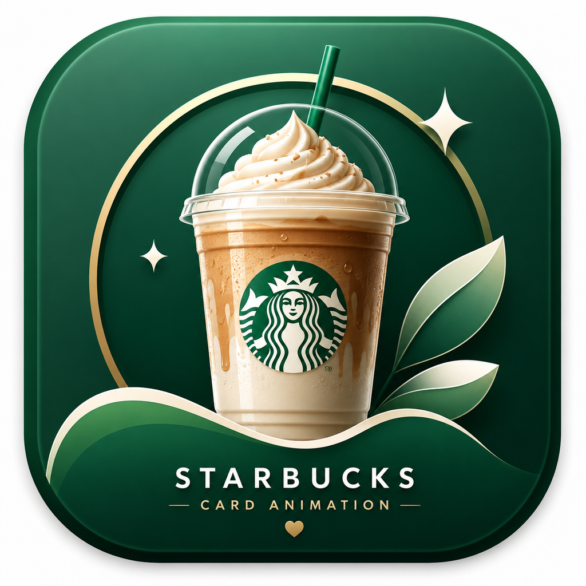
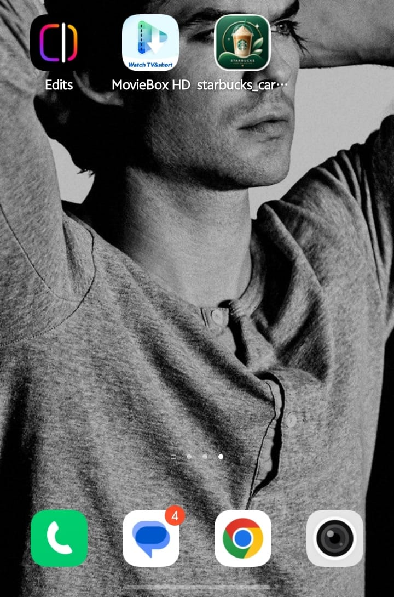
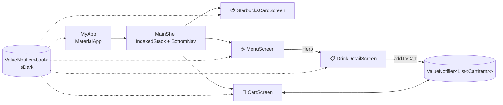

<!-- ═══════════════════════════ HEADER ═══════════════════════════ -->
<p align="center">
  
</p>

<p align="center">
  <a href="https://github.com/HammasT1/starbucks_card_animation">
    
  </a>
</p>

<p align="center">
  
  
  
  
</p>

<p align="center">
  
  
  
  
</p>

<p align="center">
  <a href="#-overview">Overview</a> •
  <a href="#-preview">Preview</a> •
  <a href="#-features">Features</a> •
  <a href="#-animation-breakdown">Animations</a> •
  <a href="#%EF%B8%8F-architecture">Architecture</a> •
  <a href="#-getting-started">Getting Started</a> •
  <a href="#-roadmap">Roadmap</a>
</p>


## 📖 Overview

**Starbucks Card Animation** is a Flutter showcase app that reimagines a coffee rewards experience with motion at its core. Swipe through a deck of **3D-tilting gift cards** whose colours bleed into the background, browse a menu of **14 handcrafted drinks**, open a detail page with a **Hero transition**, and build an order in a **live-updating cart**, all with a smooth animated **dark / light theme** switch.

Every effect is written with Flutter's built-in animation APIs (`AnimationController`, `Tween`, `Hero`, `Matrix4`, implicit animations). The app uses **no third-party animation packages.**


## 🎬 Preview

<p align="center">
  
</p>

<div align="center">

|                                                  🏠 My Cards                                                  |                                                  ☕ Menu                                                  |                                                       📋 Drink Details                                                        |
| :-----------------------------------------------------------------------------------------------------------: | :-------------------------------------------------------------------------------------------------------: | :---------------------------------------------------------------------------------------------------------------------------: |
|  |  |  |

</div>

<details>
<summary><b>🎨 App icon & home-screen view</b> (click to expand)</summary>
<br />

<div align="center">

|                                                         App Icon                                                          |                                                      On Device                                                       |
| :-----------------------------------------------------------------------------------------------------------------------: | :------------------------------------------------------------------------------------------------------------------: |
|  |  |

</div>
</details>


## ✨ Features

<table>
  <tr>
    <td width="50%" valign="top">
      <h3>💳 My Cards</h3>
      <ul>
        <li>Six themed cards: <i>Classic Green, Mocha Reserve, Gold Reserve, Berry Bliss, Ocean Breeze, Autumn Ember</i></li>
        <li>Perspective <b>3D Y-axis tilt</b> and depth scaling while swiping</li>
        <li>Background gradient <b>morphs</b> to each card's palette</li>
        <li>Floating particles, pulsing radial glow & card shimmer</li>
        <li>Bobbing, gently rotating cup illustration</li>
      </ul>
    </td>
    <td width="50%" valign="top">
      <h3>☕ Menu</h3>
      <ul>
        <li><b>14 drinks</b> across <i>Hot</i>, <i>Cold</i> & <i>Seasonal</i> categories</li>
        <li>Staggered entrance animations for the drink grid</li>
        <li>Unique gradient & accent colour for every drink</li>
        <li><code>Hero</code> cup images that fly into the detail page</li>
      </ul>
    </td>
  </tr>
  <tr>
    <td width="50%" valign="top">
      <h3>📋 Drink Details</h3>
      <ul>
        <li>Description, origin, ingredients & calories</li>
        <li>Animated <b>Tall / Grande / Venti</b> size selector</li>
        <li>Floating cup with continuous bob animation</li>
        <li>Quantity picker with live price: <i>Add 2 to Cart • $10.90</i></li>
      </ul>
    </td>
    <td width="50%" valign="top">
      <h3>🛒 Cart & Theme</h3>
      <ul>
        <li>Live cart badge on the bottom navigation bar</li>
        <li>Quantity stepper, remove item & running total</li>
        <li>Items merge automatically by drink + size</li>
        <li>Animated 🌙 / ☀️ toggle with glowing thumb</li>
      </ul>
    </td>
  </tr>
</table>


## 🎞 Animation Breakdown

The card screen alone runs **seven coordinated `AnimationController`s**, merged into a single `AnimatedBuilder` so each frame rebuilds once:

| Controller | Duration | Drives | Technique |
| :--- | :---: | :--- | :--- |
| `_logoCtrl` | 12 s, loop | Cup sway / rotation | `Tween(0 → 2π)` + `sin()` phase offset per card |
| `_bobCtrl` | 2.2 s, reverse | Vertical floating motion (±10 px) | `CurvedAnimation` · `easeInOut` |
| `_glowCtrl` | 1.6 s, reverse | Pulsing halo behind the card | Alpha tween on a `RadialGradient` |
| `_particleCtrl` | 5 s, loop | Drifting background particles | Looping value mapped to positions |
| `_bgCtrl` | 450 ms | Background colour morph between cards | `ColorTween` on both gradient stops |
| `_entryCtrl` | 900 ms | Springy card pop-in on page change | `ScaleTransition` · `elasticOut` |
| `_shimmerCtrl` | 2 s, loop | Light sweep across the card face | Animated `LinearGradient` alignment |

The menu grid uses a staggered `TweenAnimationBuilder` (`400 ms + i × 80 ms`) to slide and scale each drink in.

The 3D tilt is computed per frame from the `PageController` offset:

```dart
final delta = idx - _pageOffset;
final matrix = Matrix4.identity()
  ..setEntry(3, 2, 0.001)   // perspective
  ..rotateY(delta * 0.07);  // tilt away from the centre card
```


## 🏗️ Architecture



- **State management:** lightweight global `ValueNotifier`s for the theme and cart, consumed with `ValueListenableBuilder` / `AnimatedBuilder`. No external state library needed.
- **Navigation:** `IndexedStack` keeps every tab alive, so animations and scroll positions survive tab switches.
- **Theming:** Material 3 `ColorScheme.fromSeed` with Starbucks green `#00704A` as the seed, for both light and dark modes.

<details>
<summary><b>📁 Project structure</b></summary>

```text
starbucks_card_animation/
├── lib/
│   └── main.dart          # App, screens, models, cart & theme logic
├── images/                # Cup artwork, logo, screenshots & demo GIF
├── test/
│   └── widget_test.dart
├── android/  ios/  web/   # Platform runners
├── linux/  macos/  windows/
└── pubspec.yaml
```

</details>

<details>
<summary><b>🎨 Brand palette</b></summary>
<br />

| Swatch | Name | Hex |
| :---: | :--- | :--- |
|  | Starbucks Green | `#00704A` |
|  | House Green | `#1E3932` |
|  | Rewards Gold | `#CBA258` |
|  | Mocha | `#6F4E37` |

</details>


## 🚀 Getting Started

### Prerequisites

- [Flutter SDK](https://docs.flutter.dev/get-started/install) with Dart **3.9** or newer
- An emulator, a physical device, or Chrome for the web build

### Installation

```bash
# 1. Clone the repository
git clone https://github.com/HammasT1/starbucks_card_animation.git

# 2. Move into the project
cd starbucks_card_animation

# 3. Fetch dependencies
flutter pub get

# 4. Run it 🚀
flutter run
```

### Useful commands

| Command | Purpose |
| :--- | :--- |
| `flutter run -d chrome` | Run in the browser |
| `flutter run --release` | Run with release performance (smoothest animations) |
| `flutter build apk --release` | Build an Android APK |
| `flutter analyze` | Static analysis with `flutter_lints` |
| `flutter test` | Run widget tests |

> [!TIP]
> Animations look their best in **profile** or **release** mode. Debug mode adds overhead that can make motion appear choppy.


## 🗺 Roadmap

- [x] Swipeable 3D card carousel with particles & shimmer
- [x] Menu with Hero transitions to drink details
- [x] Cart with quantities and totals
- [x] Animated dark / light theme
- [ ] Split `main.dart` into feature folders
- [ ] Persist cart & theme with local storage
- [ ] Card flip animation revealing a barcode on the back
- [ ] Golden & widget tests for each screen

## 🤝 Contributing

Contributions, issues and feature requests are welcome.

1. Fork the project
2. Create your branch: `git checkout -b feature/amazing-feature`
3. Commit your changes: `git commit -m "Add amazing feature"`
4. Push the branch: `git push origin feature/amazing-feature`
5. Open a Pull Request

## ⚖️ Disclaimer

This is an independent, non-commercial UI/animation study made for learning and portfolio purposes. It is **not affiliated with, endorsed by, or sponsored by Starbucks Corporation**. *Starbucks* and related marks are trademarks of their respective owner.


<div align="center">

### 👨‍💻 Author

**Muhammad Hammas Rasheed**

<a href="https://github.com/HammasT1">
  
</a>

<br /><br />

If you enjoyed this project, please consider giving it a ⭐. It really helps!

</div>

<p align="center">
  
</p>
